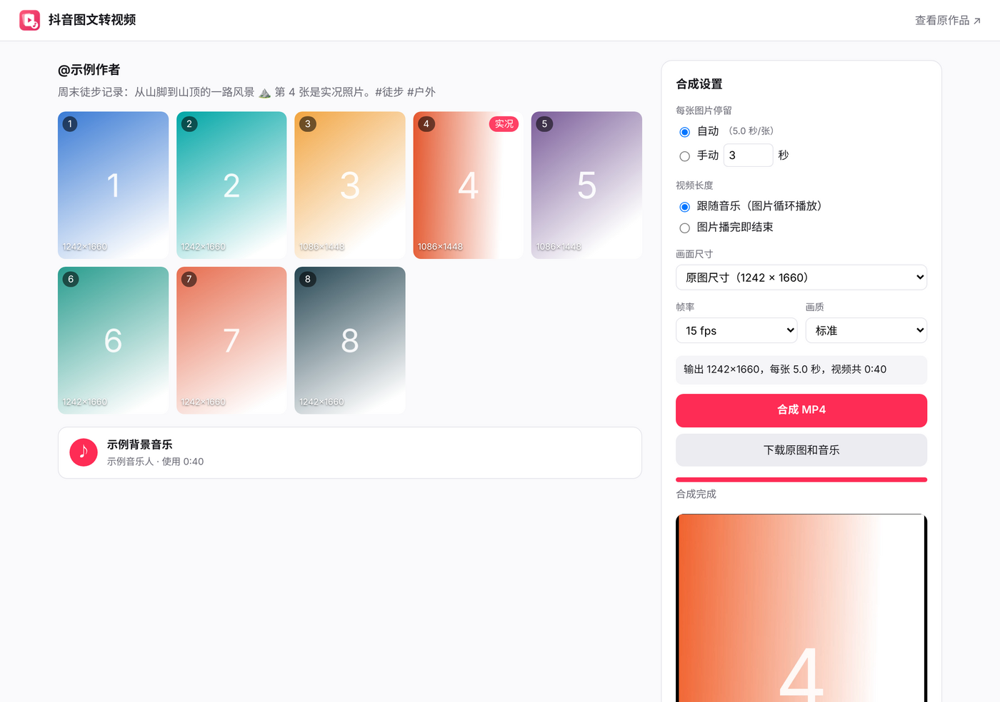
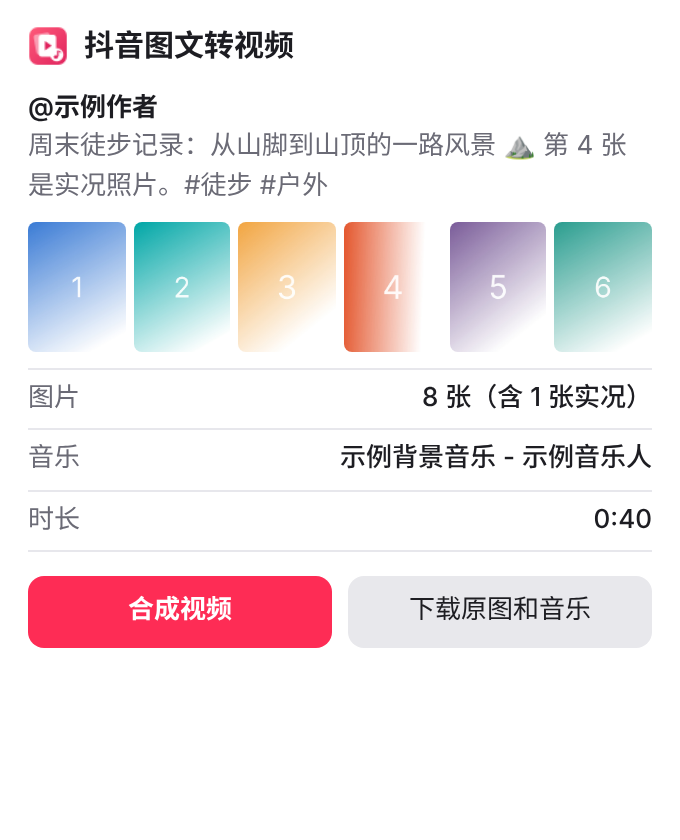

<p align="center">
  
</p>

<h1 align="center">抖音图文转视频</h1>

<p align="center">
  把抖音「图文」作品的无水印原图和背景音乐，在浏览器里一键合成为 MP4 视频。
</p>

<p align="center">
  <a href="LICENSE"></a>
  
  
</p>

<p align="center">简体中文 · <a href="#english">English</a></p>

---

<p align="center">
  
</p>

## 为什么需要这个

抖音的「图文」作品（网址形如 `douyin.com/note/…`）是**多张图片 + 一段背景音乐**，播放时由 App 或网页即时拼起来，**服务器上并不存在合成好的视频文件**。所以 Video DownloadHelper 之类的工具只能抓到那段音乐（mp3），抓不到「带音乐的视频」。

这个插件直接读取页面里的作品数据，取出每张图片的**无水印原图**（不用 `downloadUrlList` 里那组带水印的地址）和背景音乐，然后在你的浏览器本地用 [ffmpeg.wasm](https://github.com/ffmpegwasm/ffmpeg.wasm) 合成为 MP4。

## 功能

| 功能 | 说明 |
| --- | --- |
| 🎬 合成视频 | 图片 + 背景音乐 → H.264 / AAC 的 MP4，手机、电脑、剪辑软件都能直接用 |
| ⏱️ 自动对齐音乐 | 默认把音乐时长平均分给每张图片；也可手动设定每张秒数，并选择「跟随音乐循环」或「图片播完即结束」 |
| 📐 输出尺寸 | 原图尺寸、1080×1920（9:16）、1080×1440（3:4）、1080×1080、720×1280；尺寸不同的图片自动等比缩放并补黑边 |
| 🖼️ 下载素材 | 一键下载全部无水印原图、背景音乐和文案，实况照片会一并下载其视频片段 |
| 🔒 完全本地 | 下载和合成都在你的浏览器里完成，不经过任何第三方服务器 |

支持直接打开的作品页（`/note/…`），也支持在推荐流、个人主页里点开的作品（网址带 `?modal_id=…`）。

## 使用

1. 在 Chrome 打开一个抖音图文作品
2. 点工具栏上的插件图标（或按 `Alt+Shift+D`），弹窗会显示图片数量、音乐和时长
3. 点「合成视频」打开工作台，调整设置后点「合成 MP4」
4. 合成完成后可直接预览，点「保存视频」存到下载文件夹的 `抖音图文/` 目录

<p align="center">
  
</p>

**合成要多久？** 取决于电脑性能。以 11 张图、111 秒、1242×1660、15 fps 为例，一般电脑约 1～2 分钟。选 720×1280 或 10 fps 会更快。

## 安装

### 从源码安装（开发者模式）

1. 下载本仓库（`git clone` 或 Code → Download ZIP 后解压）
2. Chrome 打开 `chrome://extensions`
3. 右上角开启「开发者模式」
4. 点「加载已解压的扩展程序」，选择仓库中的 **`extension`** 文件夹

> ffmpeg.wasm（约 32 MB）已经放在 `extension/vendor/` 里，不需要额外构建，下载后就能直接加载。

### Chrome 网上应用店

（上架后补上链接）

## 隐私

插件**不收集、不上传任何数据**，也没有任何统计或广告代码。详见 [PRIVACY.md](PRIVACY.md)。

| 权限 | 用途 |
| --- | --- |
| `*.douyin.com` | 读取当前作品页里的图片和音乐地址 |
| `*.douyinpic.com` 等抖音 CDN | 下载原图、音乐和实况照片片段 |
| `scripting` | 插件安装前就已打开的抖音页面，点图标时补注入读取脚本 |
| `declarativeNetRequest` | 只给**本插件自己**发出的素材请求补上 `Referer: https://www.douyin.com/`，不影响任何网页 |
| `downloads` | 保存视频和素材到下载文件夹 |
| `storage` | 在弹窗和工作台之间临时传递作品数据（`chrome.storage.session`，关闭浏览器即清空） |

## 已知限制

- 只处理**图文作品**。普通视频作品本身就有视频文件，请用其他工具下载
- **实况照片**合成时使用静态图；素材下载会一并保存实况视频片段
- 素材链接带有时效签名，页面打开太久后可能下载失败，**刷新抖音页面**后重新点插件即可
- 不支持需要付费或仅好友可见、你本身无权查看的内容
- 抖音改版可能导致读取失败，欢迎提 [Issue](../../issues)

## 开发

```bash
npm test          # 运行解析与合成参数的单元测试（需 Node.js 18+）
npm install       # 安装 @ffmpeg/ffmpeg 与 @ffmpeg/core
npm run vendor    # 把 ffmpeg.wasm 复制到 extension/vendor/（升级版本时用）
npm run build     # 打包为 dist/douyin-note-to-video-vX.Y.Z.zip，可直接上传应用店
```

项目结构：

```
extension/            插件本体（加载这个文件夹）
  manifest.json
  lib/parse.js        作品数据解析、合成参数生成（纯函数，有单元测试）
  hook.js             页面环境：缓存单页应用中接口返回的作品数据
  content.js          读取当前作品（接口缓存 → 页面 SSR 数据 → 重新请求页面）
  background.js       为素材请求补 Referer
  popup.html/js/css   弹窗
  studio.html/js/css  合成工作台（运行 ffmpeg.wasm）
  vendor/             ffmpeg.wasm（由 npm run vendor 生成）
  icons/
assets/               图标源文件与截图
test/                 单元测试与脱敏的测试数据
scripts/              vendor.sh、build.sh
```

**合成流程**：每张图先单独缩放补边到统一尺寸（若直接用 concat 拼接不同尺寸的图片，ffmpeg 会在尺寸变化时重建滤镜而丢掉前一张），再用 concat demuxer 按时长排列，与音乐一起编码为 `libx264` + `aac`，`-tune stillimage`、`-movflags +faststart`。

欢迎提 Issue 和 PR，参见 [CONTRIBUTING.md](CONTRIBUTING.md)。

## 免责声明

本项目为个人开源工具，与抖音、字节跳动没有任何关联。「抖音」为其各自所有者的商标。请仅用于保存你有权使用的内容，尊重原作者的著作权，并遵守当地法律和平台的服务条款。

## License

本项目源代码以 [MIT](LICENSE) 授权。随附的 `extension/vendor/ffmpeg-core/`（FFmpeg + libx264 编译的 WebAssembly）以 GPL-2.0-or-later 授权，详见 [extension/vendor/README.md](extension/vendor/README.md)。

---

<a id="english"></a>

## English

A Chrome extension (Manifest V3) that turns a Douyin (Chinese TikTok) **image post** (a "图文" post: several photos plus background music) into a single MP4 video, entirely in your browser with [ffmpeg.wasm](https://github.com/ffmpegwasm/ffmpeg.wasm).

**Why:** Douyin image posts are assembled on the fly by the app or web page. No pre-rendered video exists on the server, so generic video downloaders only find the background music. This extension reads the post data from the page, picks the **watermark-free** original images (never the watermarked `downloadUrlList`), fetches the music and composes the video locally.

**Features**

- **Compose MP4**: H.264 + AAC output that plays everywhere.
- **Timing**: by default, the music length is split evenly across the images. You can also set seconds per image and choose between looping the images until the music ends or stopping after the last image.
- **Output size**: original, 1080×1920 (9:16), 1080×1440 (3:4), 1080×1080, or 720×1280. Mixed image sizes are letterboxed automatically.
- **Download assets**: saves all original images, the music, and the caption. Live-photo clips are included.
- **100% local**: nothing is uploaded, and there is no analytics. See [PRIVACY.md](PRIVACY.md).

**Usage:** open a Douyin image post, click the toolbar icon (or press `Alt+Shift+D`), click "合成视频" (Compose video), then "合成 MP4". Save the result with "保存视频". Works on `/note/…` pages and on posts opened from the feed (`?modal_id=…`).

**Install from source:** clone or download this repo, open `chrome://extensions`, enable Developer mode, click "Load unpacked" and select the `extension` folder. ffmpeg.wasm (~32 MB) is already vendored, so no build step is needed.

**Limitations:** image posts only. Live photos use the still frame when composing. Media URLs are signed and expire, so reload the Douyin page if a download fails.

**Develop:** `npm test` runs the unit tests. `npm install && npm run vendor` refreshes ffmpeg.wasm. `npm run build` creates a store-ready zip in `dist/`.

Not affiliated with Douyin or ByteDance. Only save content you have the right to use. Source code is licensed under [MIT](LICENSE). The bundled `extension/vendor/ffmpeg-core/` is GPL-2.0-or-later.
